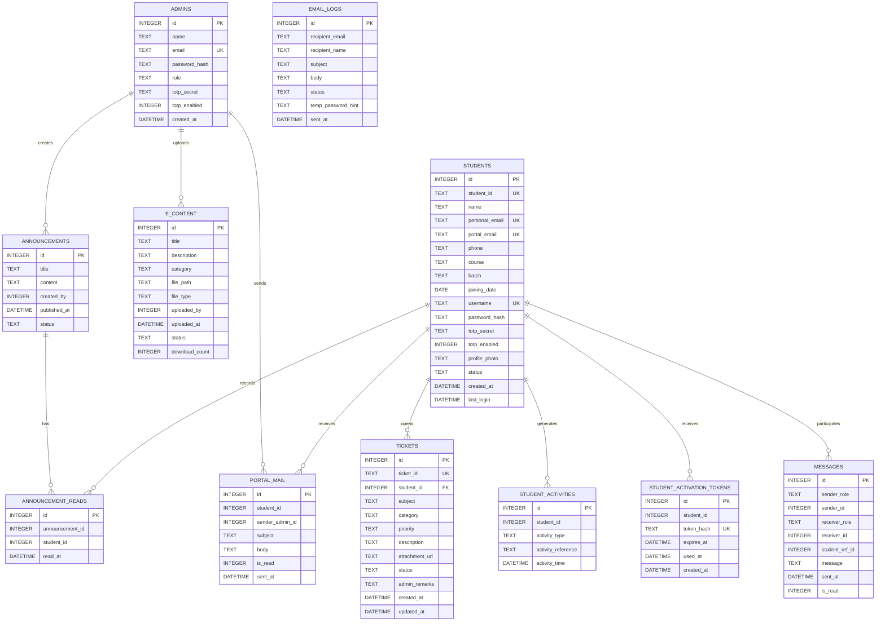

# EduPortal Database Design

## Scope

This design documents the tables created by the application at runtime in `backend/config/db.js`. The application defaults to SQLite (`DB_TYPE=sqlite`) and also includes PostgreSQL and MySQL schema files. Those SQL files are not fully synchronized with the runtime tables, so use the runtime initializer as the reference for the default SQLite deployment.

## Entity-Relationship Diagram

`MESSAGES.sender_id` and `MESSAGES.receiver_id` are polymorphic identifiers: the corresponding account table is determined by `sender_role` or `receiver_role`. `student_ref_id` identifies the student conversation context.

The diagram shows logical relationships. In the SQLite runtime initializer, only `tickets.student_id` is declared as a foreign key; other relationship columns are not database-enforced.

## Table Design

| Table | Purpose | Key rules |
|---|---|---|
| `admins` | Administrator accounts and authentication settings. | `id` primary key; `email` unique. Runtime initialization also adds `role`, defaulting to `admin`. |
| `students` | Student identity, contact, course, login, and profile details. | `id` primary key; `student_id`, `personal_email`, `username`, and non-null `portal_email` values are unique when supplied. |
| `announcements` | Notices authored by administrators. | `created_by` logically identifies an admin; title, content, and author are required. |
| `e_content` | Learning resources uploaded by administrators. | `uploaded_by` logically identifies an admin; stores a path or link and a download counter. |
| `messages` | Student-admin conversation messages. | Stores sender and receiver role/id plus the student conversation reference; read state defaults to false. |
| `tickets` | Student support requests and administrator responses. | `ticket_id` is unique; `student_id` references `students.id` and may be null; status defaults to `Pending`. |
| `student_activities` | Student activity/audit events. | `student_id` logically identifies a student; each row stores an activity type, optional reference, and time. |
| `announcement_reads` | Tracks which students have read each announcement. | Unique pair `(announcement_id, student_id)`; both IDs logically identify their parent records. |
| `student_activation_tokens` | Hashed, expiring student activation tokens. | `token_hash` is unique; `student_id` logically identifies a student; expiry and optional use time support one-time activation. |
| `portal_mail` | Administrator-to-student portal inbox messages. | `student_id` and required `sender_admin_id` logically identify their respective records. |
| `email_logs` | Records onboarding and other email dispatch attempts. | Stores recipient, subject, message body, status, and send time; it is not linked to an account by a foreign key. |

## Relationships and Cardinality

- One administrator can create many announcements and upload many learning resources.
- One student can open many tickets, generate many activity records, receive many activation tokens, and receive many portal-mail messages.
- One announcement can be read by many students, and one student can read many announcements. `announcement_reads` implements this many-to-many relationship and prevents duplicate read records per student-announcement pair.
- A conversation can contain many messages. Each message has one sender and one receiver, either an administrator or a student; role/id pairs are polymorphic and are not conventional foreign keys.
- Email logs are independent audit records and have no declared account relationship.

## Integrity and Implementation Notes

- SQLite is the default runtime database. The initializer creates eleven tables and declares only `tickets.student_id` as a foreign key, so most logical relationships are not database-enforced. Enable SQLite foreign-key enforcement and add missing constraints/indexes if strict referential integrity is required.
- The PostgreSQL and MySQL schema files currently differ from one another and from the SQLite runtime initializer. For example, runtime SQLite includes `joining_date` and `admins.role`, while the MySQL schema omits tickets, activation tokens, and portal mail. Reconcile these definitions before using a non-SQLite deployment or treating a SQL file as the canonical schema.
- Status and role fields are plain text in the runtime schema; allowed values are enforced by application logic rather than database check constraints.
- `email_logs.temp_password_hint` should not contain a usable password or credential. Store only non-sensitive diagnostic information there.
